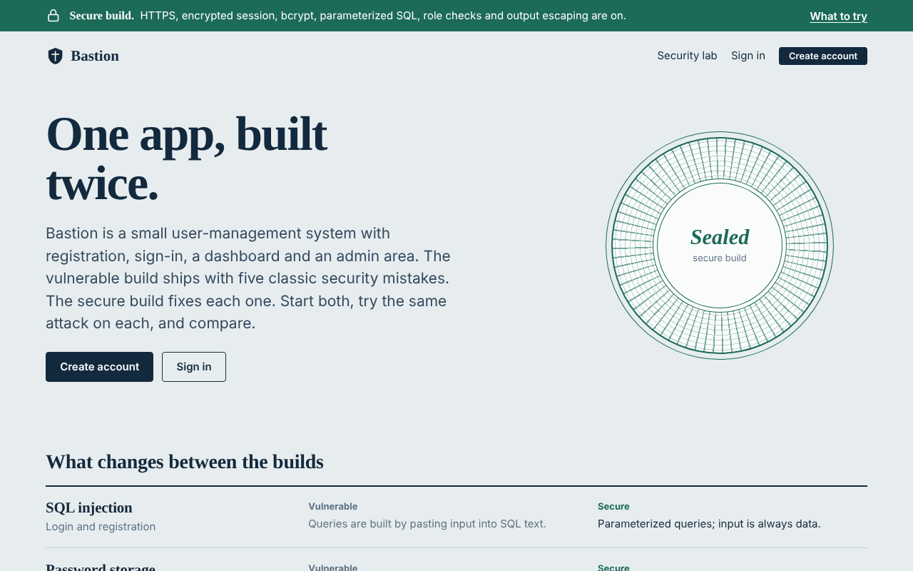
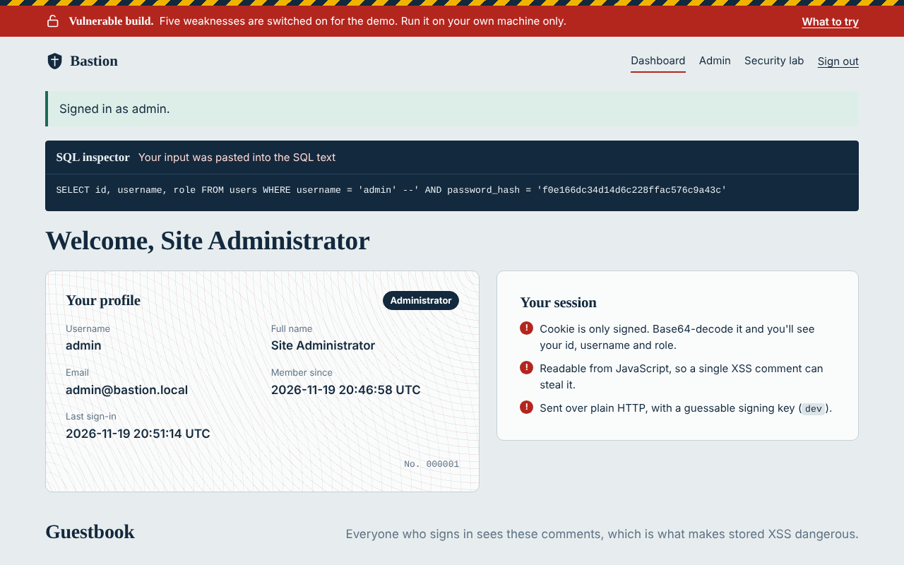
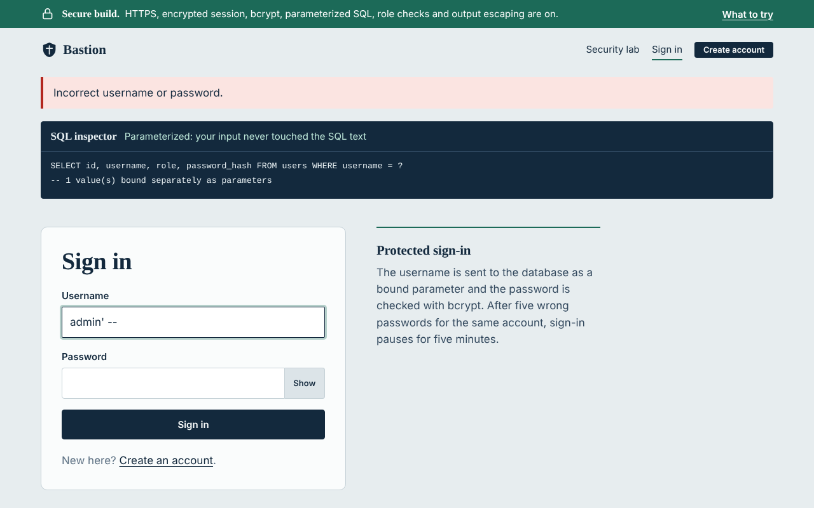

# Bastion: a secure web application, built twice

Bastion is a small user-management web app (register, sign in, dashboard, admin area) written in **Python / Flask**.
The same code base runs as two builds:

| Build | Command | URL | Purpose |
|---|---|---|---|
| **Vulnerable** | `python run.py --mode vulnerable` | http://127.0.0.1:5000 | The "before" state: five deliberate weaknesses |
| **Secure** | `python run.py --mode secure` | https://127.0.0.1:5443 | The "after" state: every weakness fixed, plus extra hardening |

Every place where the builds differ is marked in the code with `# VULNERABLE:` and `# SECURE:` comments,
so each fix can be read next to the flaw it replaces. A coloured band at the top of every page shows which
build is running, and the built-in **Security lab** page (`/lab`) lists every attack with a one-click payload.



| Same attack (`admin' --`), vulnerable build | Same attack, secure build |
|---|---|
|  |  |

The full write-up (vulnerabilities, fixes, testing table, access-control matrix, challenges) is in
**[SECURITY_REPORT.md](	bastion/SECURITY_REPORT.md)**.

---

## Features

- **Registration** with username, password, optional full name and email. The secure build shows the password
  rules and ticks them off live as you type.
- **Sign in / sign out.** Logout ends the session on the server; Back button or typing `/dashboard` afterwards
  lands on the sign-in page.
- **Dashboard** with the user's profile (username, full name, email, role, member since, last sign-in),
  session details and a shared guestbook.
- **Admin page** (`/admin`): list users, promote/demote roles, moderate comments.
- **SQL inspector**: after a sign-in or registration, a panel shows the exact SQL that ran. In the vulnerable build
  you can watch the payload rewrite the query; in the secure build you see only `?` placeholders.

## Vulnerabilities and fixes at a glance

| # | Vulnerability | Vulnerable build | Secure build |
|---|---|---|---|
| 1 | SQL injection | Login and registration build SQL with f-strings | Parameterized queries (`?` placeholders) |
| 2 | Weak password storage | Unsalted MD5, no rules | bcrypt (cost 12, per-user salt) + password policy |
| 3 | Cross-site scripting | Comments rendered with the `safe` filter (no escaping) | Tags stripped on input, autoescaped output, CSP |
| 4 | Broken access control | `/admin` only checks "logged in" | Role-based check on every admin route (RBAC) |
| 5 | Missing encryption | Readable cookie over HTTP, email in plain text | HTTPS (TLS 1.2+), Fernet-encrypted cookie and email |

Extra hardening in the secure build: CSRF tokens, login throttling, server-side session revocation,
session regeneration at login, security headers (CSP, HSTS, X-Frame-Options, nosniff, Referrer-Policy),
generic login errors, timing-safe login.

---

## Project structure

```
bastion/
├── run.py                    # entry point: --mode vulnerable | secure
├── requirements.txt
├── app/
│   ├── __init__.py           # app factory, per-mode configuration
│   ├── db.py                 # SQLite schema, safe vs unsafe query helpers
│   ├── models.py             # users & comments; vulnerable/secure versions side by side
│   ├── routes/
│   │   ├── auth.py           # register, login, logout
│   │   ├── main.py           # home, dashboard, comments, security lab
│   │   └── admin.py          # admin panel (RBAC-protected)
│   ├── security/
│   │   ├── passwords.py      # MD5 vs bcrypt, password policy
│   │   ├── sanitize.py       # XSS input sanitizer
│   │   ├── access.py         # login_required, role_required (RBAC)
│   │   ├── session.py        # Fernet-encrypted session cookie + server-side revocation
│   │   ├── crypto.py         # field encryption at rest
│   │   ├── keys.py           # key generation / loading
│   │   ├── tls.py            # self-signed certificate, TLS 1.2+ context
│   │   ├── csrf.py           # CSRF tokens
│   │   ├── headers.py        # security + no-cache headers
│   │   └── ratelimit.py      # login throttling
│   ├── templates/            # Jinja2 templates (no inline JS/CSS, CSP-friendly)
│   └── static/               # CSS, JS
├── scripts/
│   ├── inspect_db.py         # show what is really stored (hashes, encrypted email)
│   └── inspect_cookie.py     # try to read a session cookie without the key
├── tests/
│   └── test_security.py      # 31 automated attacks against both builds

└── README.md
```

---

## Running the application

**Requirements:** Python 3.10 or newer.

```bash
# 1. Get the code
git clone <your-repo-url> bastion
cd bastion

# 2. Create a virtual environment and install dependencies
python -m venv .venv
# macOS / Linux:
source .venv/bin/activate
# Windows (PowerShell):
.venv\Scripts\Activate.ps1

pip install -r requirements.txt

# 3a. Start the vulnerable build
python run.py --mode vulnerable          # http://127.0.0.1:5000

# 3b. Start the secure build (in a second terminal, both can run at once)
python run.py --mode secure              # https://127.0.0.1:5443
```

On first start of the secure build a self-signed certificate is created in `instance/`. Your browser will warn
about it once: choose **Advanced → Proceed to 127.0.0.1**. (For a warning-free local certificate, generate one
with [mkcert](https://github.com/FiloSottile/mkcert) and set `BASTION_TLS_CERT` / `BASTION_TLS_KEY`.)

Add `--reset-db` to start a build with an empty database.

### Demo accounts

Both builds create these accounts on first start:

| Role | Username | Password |
|---|---|---|
| Administrator | `admin` | `Admin@2026!` |
| Standard user | `alice` | `Alice@2026!` |

Override them with the `BASTION_ADMIN_PASSWORD` and `BASTION_USER_PASSWORD` environment variables.

### What is created at runtime (and ignored by Git)

`instance/` holds the two SQLite databases (`vulnerable.db`, `secure.db`), the secret keys
(`secret.key`, `session.key`, `data.key`, file mode 600) and the TLS certificate. None of it is committed.
In production the keys would come from environment variables (`BASTION_SECRET_KEY`, `BASTION_SESSION_KEY`,
`BASTION_DATA_KEY`) or a secrets manager.

---

## Testing the security features

Open `/lab` in either build for the same steps with copy buttons. Run each test in the vulnerable build first,
then repeat it in the secure build.

### 1. SQL injection

**Login bypass.** On *Sign in*, enter username `admin' --` and any password.
- Vulnerable: signed in as admin. The SQL inspector shows `... WHERE username = 'admin' --' AND password_hash = ...`;
  the password check is commented out. `' OR '1'='1' --` works too.
- Secure: "Incorrect username or password." The inspector shows `WHERE username = ?`.

**Privilege escalation through registration.** On *Create account*, choose any username/password and enter
`Mallory', 'admin')--` as **Full name**.
- Vulnerable: the account is created with role `admin`; sign in and the Admin link appears.
- Secure: the account is a standard user and the full name is stored literally.

**Error leakage.** Enter a single `'` as the username.
- Vulnerable: the raw SQLite error is shown. Secure: the normal generic message.

### 2. Weak password storage

Register a user with the password `123`, then run:

```bash
python scripts/inspect_db.py --mode vulnerable
python scripts/inspect_db.py --mode secure
```

- Vulnerable: `123` is accepted and stored as `202cb962ac59075b964b07152d234b70` (MD5, reversible with any lookup site).
  The admin page also shows each user's hash.
- Secure: `123` is rejected with the list of missing requirements (8+ characters, upper, lower, number,
  special character). Valid passwords are stored as `$2b$12$...`; two users with the same password get different hashes.

### 3. Cross-site scripting (stored XSS)

Sign in, go to the dashboard guestbook and post `<script>alert(document.cookie)</script>`
(or ``).
- Vulnerable: a pop-up shows the session cookie, for every user who opens the dashboard.
- Secure: no pop-up; the tags are removed and the remaining text is shown escaped. Response headers include
  `Content-Security-Policy: ... script-src 'self'`.

### 4. Access control (RBAC)

Sign in as `alice` (standard user) and open `/admin` directly.
- Vulnerable: the page opens (the link is only hidden from the menu); alice can press **Make admin** on herself.
- Secure: **403 Forbidden**. Signed out, `/admin` redirects to sign-in. Sign in as `admin` and the page works.

### 5. Encryption (session cookie, data at rest, HTTPS)

Sign in, open the browser dev tools → *Application* → *Cookies*, copy the session cookie value and run:

```bash
python scripts/inspect_cookie.py "<cookie value>"
```

- Vulnerable: the cookie (`session`) decodes to readable JSON (`user_id`, `username`, `role`); it is not HttpOnly and
  travels over plain HTTP. `inspect_db.py` shows email addresses in plain text.
- Secure: the cookie (`__Host-bastion_session`) is a Fernet token (`gAAAAA...`) with `Secure`, `HttpOnly` and
  `SameSite=Strict`; nothing readable comes out. Email addresses are stored encrypted. The site is served only over
  HTTPS; `openssl s_client -connect 127.0.0.1:5443 -tls1_1` fails, and a normal connection negotiates TLS 1.3.

### Logout behaviour (both builds)

Sign in, open the dashboard, click **Sign out**, then press the browser **Back** button or type `/dashboard`:
you land on the sign-in page. In the secure build even a copy of the old cookie is refused, because logout deletes
the session id on the server.

### Automated attack suite

```bash
python -m unittest -v
```

31 tests run every attack against both builds: in the vulnerable build each attack must **succeed**,
in the secure build each must **fail**. (Messages such as `WARNING in access: Access denied` in the output are the
app logging blocked admin attempts, as intended.)

---

## Configuration

| Variable | Default | Purpose |
|---|---|---|
| `BASTION_ADMIN_PASSWORD` | `Admin@2026!` | Seeded admin password |
| `BASTION_USER_PASSWORD` | `Alice@2026!` | Seeded standard-user password |
| `BASTION_SQL_INSPECTOR` | `1` | Set to `0` to hide the SQL inspector panel |
| `BASTION_SECRET_KEY`, `BASTION_SESSION_KEY`, `BASTION_DATA_KEY` | generated | Supply keys from the environment |
| `BASTION_TLS_CERT`, `BASTION_TLS_KEY` | generated | Use your own certificate |

---

## Credits and references

Libraries: [Flask](https://flask.palletsprojects.com/) (web framework, Jinja2 templates),
[bcrypt](https://pypi.org/project/bcrypt/) (password hashing),
[cryptography](https://cryptography.io/) (Fernet encryption, certificate generation).
Python standard library: `sqlite3`, `html.parser`, `secrets`, `hmac`, `ssl`.

Guidance consulted:
- OWASP Top 10 (2021): A01 Broken Access Control, A02 Cryptographic Failures, A03 Injection, A07 Identification and Authentication Failures
- OWASP Cheat Sheets: SQL Injection Prevention, Password Storage, Cross Site Scripting Prevention, Session Management, Authorization, CSRF Prevention, HTTP Security Response Headers
- Flask documentation: Security Considerations; Python `sqlite3` documentation on placeholders

> **Warning:** the vulnerable build is intentionally insecure. Run it only on `127.0.0.1` and never deploy it.
