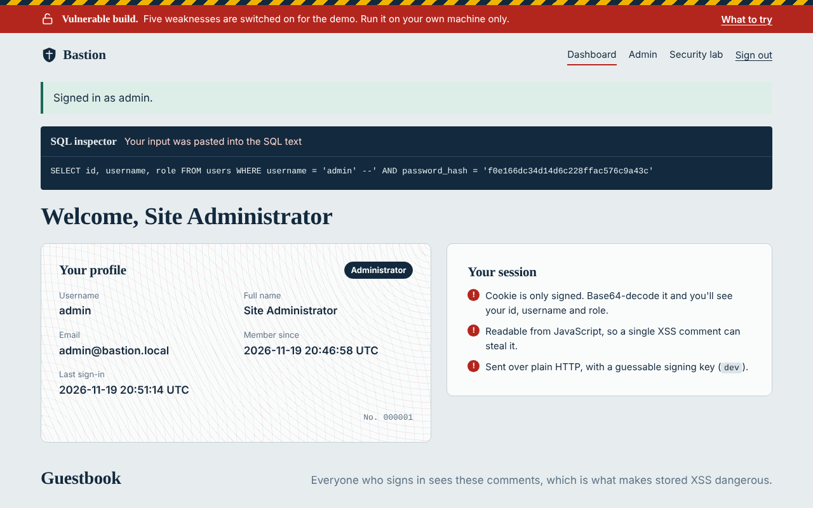
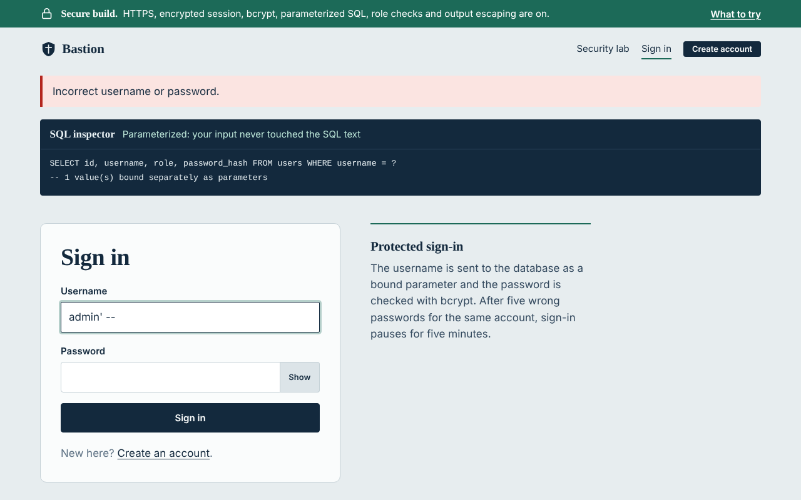
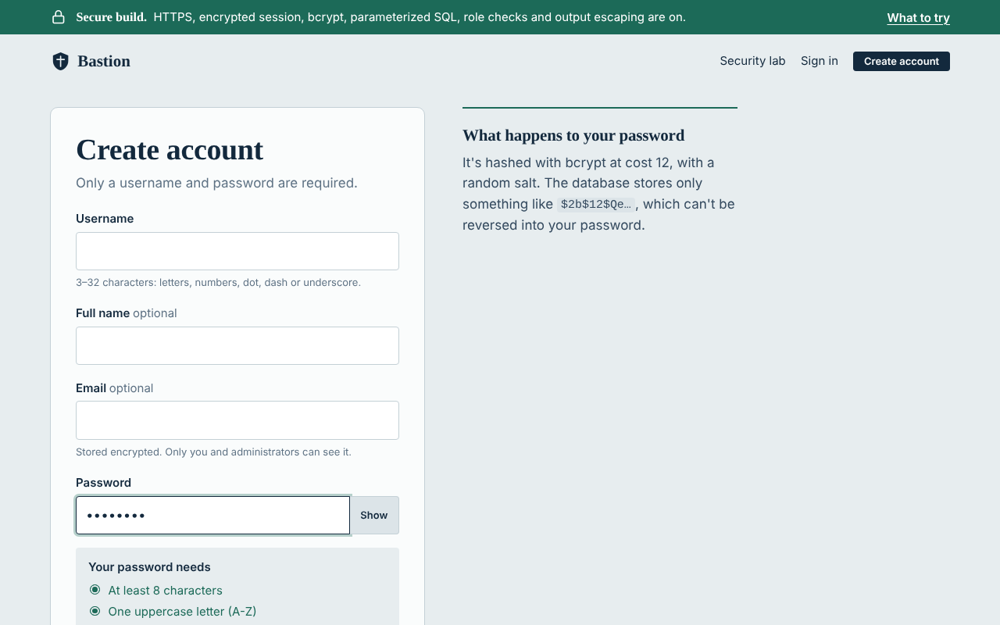
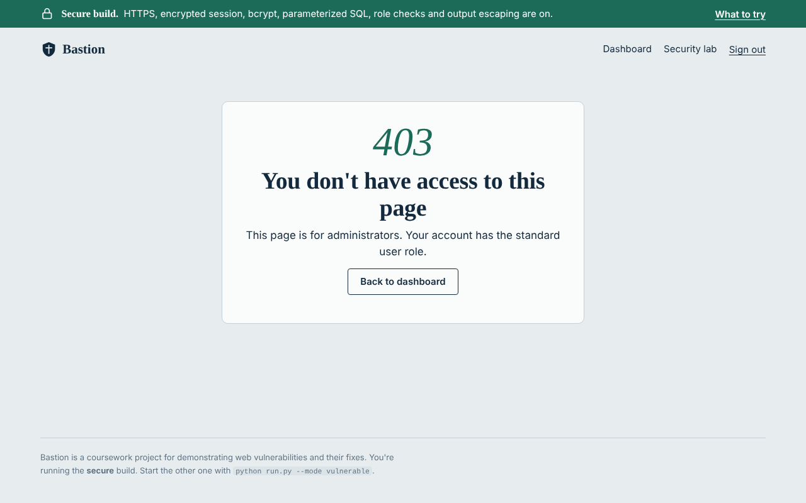

# Security Report: Bastion

**Project:** Building a Secure Web Application – Detection and Mitigation of Security Vulnerabilities
**Stack:** Python 3, Flask 3, SQLite (`sqlite3`, no ORM), Jinja2, bcrypt, cryptography (Fernet)

---

## 1. Summary

Bastion is a user-management application (registration, login, dashboard, logout, admin area, comment
guestbook). It was built so that one code base can run as a **vulnerable build** and a **secure build**,
selected with `python run.py --mode vulnerable|secure`. This makes every vulnerability reproducible and every fix
verifiable on demand, and lets a reviewer read each flawed line next to its replacement
(marked `# VULNERABLE:` / `# SECURE:` in the code).

Five vulnerabilities were introduced and then mitigated:

| # | Vulnerability | OWASP Top 10 (2021) | Fix |
|---|---|---|---|
| 1 | SQL injection in login and registration | A03 Injection | Parameterized queries |
| 2 | Weak password storage (unsalted MD5) | A02 Cryptographic Failures, A07 | bcrypt (cost 12) + password policy |
| 3 | Stored cross-site scripting in comments | A03 Injection | Input sanitization + output escaping + CSP |
| 4 | Broken access control on the admin page | A01 Broken Access Control | Server-side role-based access control |
| 5 | Unencrypted session data and transport | A02 Cryptographic Failures | Fernet-encrypted session cookie and email, HTTPS (TLS 1.2+) |

The secure build adds defence in depth: CSRF tokens, login throttling, server-side session revocation, session
regeneration at login, security headers and timing-safe login. All results were verified with an automated suite
of 31 attack tests (`tests/test_security.py`) that runs every attack against both builds.

---

## 2. How the two builds are organised

- `create_app(mode)` in `app/__init__.py` configures the app per mode (keys, cookie flags, cipher, throttle).
- Each build uses its **own database** (`instance/vulnerable.db`, `instance/secure.db`) so MD5 and bcrypt rows
  never mix.
- Security-relevant operations live in small functions with a vulnerable and a secure version side by side
  (`models._authenticate_vulnerable` / `models._authenticate_secure`, etc.). Routes contain no SQL.
- `app/db.py` exposes two kinds of helpers: `query()/execute()` (parameterized) and
  `query_unsafe()/execute_unsafe()` (pre-built SQL, used only by vulnerable code paths). Searching for `_unsafe`
  finds every injectable query.
- A demo-only **SQL inspector** shows the query that ran after login/registration. In the secure build it shows
  only the SQL template and the number of bound values, never the values.

---

## 3. Vulnerabilities and mitigations

### 3.1 SQL injection (login and registration)

**Vulnerability.** The vulnerable build builds queries by inserting form input into SQL text with f-strings
(`app/models.py`):

```python
sql = ("SELECT id, username, role FROM users "
       f"WHERE username = '{username}' AND password_hash = '{pw_hash}'")
```

Because the database cannot tell the developer's SQL from the attacker's input, a quote in the input ends the
string literal and the rest is executed as SQL.

**Exploits demonstrated.**
- *Authentication bypass:* username `admin' --` turns the query into
  `... WHERE username = 'admin' --' AND password_hash = '...'`. Everything after `--` is a comment, so the user is
  logged in as admin without a password. `' OR '1'='1' --` logs in as the first user in the table (admin).
- *Privilege escalation at registration:* the insert is
  `VALUES ('{username}', '{hash}', '{email}', '{full_name}', 'user')`. Entering `Mallory', 'admin')--` as the full
  name closes the string, supplies `'admin'` as the role and comments out the hard-coded `'user'`.
- *Error-based information leak:* a lone `'` breaks the syntax and the raw SQLite error is displayed, which helps
  an attacker shape payloads.

**Mitigation.** All queries use **parameterized statements** with `?` placeholders:

```python
row = db.query("SELECT id, username, role, password_hash FROM users WHERE username = ?",
               (username,), one=True)
```

The SQL text and the values are sent to SQLite separately; the values are bound after the statement is parsed,
so they can never change its structure. The password is no longer part of the SQL at all; it is checked in Python
with bcrypt (3.2). Usernames are additionally validated against `^[A-Za-z0-9_.-]{3,32}$`, and database errors are
never shown to users.

**Why this approach.** Parameterization fixes the root cause (mixing code and data) for every input, including
ones nobody thought to escape. Escaping or blacklisting characters is error-prone (encodings, different quote
styles, second-order injection) and is not recommended by OWASP as a primary defence.

### 3.2 Weak password storage

**Vulnerability.** Passwords were stored as unsalted MD5 (`hashlib.md5(password).hexdigest()`) with no password
rules. MD5 is fast (billions of guesses per second on a GPU) and, without a salt, the same password always gives
the same hash, so precomputed lookup tables reverse common passwords instantly (`123` →
`202cb962ac59075b964b07152d234b70`). The vulnerable admin page even displays the hashes.

**Mitigation.**
- Passwords are hashed with **bcrypt** at cost factor **12** (`app/security/passwords.py`). bcrypt generates a
  random 128-bit salt per password and stores salt and cost inside the hash (`$2b$12$<salt><hash>`).
- Verification uses `bcrypt.checkpw`, a constant-time comparison.
- A **password policy** is enforced on the server: at least 8 characters, one uppercase letter, one lowercase
  letter, one number and one special character. The same rule list (`POLICY`) is rendered on the registration
  page as a live checklist, so users see the requirements before submitting.
- To stop username discovery by timing, a dummy bcrypt check runs when the username does not exist, so both
  failure cases take the same time and return the same message.
- Hashes never leave the database in the secure build (the admin page shows only "bcrypt, cost 12").

**Why bcrypt.** It is purpose-built for passwords: deliberately slow, salted, and its cost can be raised as
hardware improves without changing the storage format. Cost 12 takes roughly a quarter of a second per hash on a
typical laptop: unnoticeable for one login, prohibitive for an attacker trying millions of guesses. It is widely
supported and recommended by OWASP's Password Storage Cheat Sheet (alongside Argon2id and scrypt).

### 3.3 Cross-site scripting (stored XSS)

**Vulnerability.** The dashboard guestbook stores comments as typed and renders them with Jinja2's `|safe`
filter, which disables escaping:

```jinja
{{ c.body|safe }}   {# VULNERABLE #}
```

A comment such as `<script>alert(document.cookie)</script>` or `` runs in the browser
of **every** user who opens the dashboard, including administrators. Combined with the non-HttpOnly cookie of the
vulnerable build, the script can read and exfiltrate the victim's session cookie (demonstrated by the alert).

**Mitigation: three independent layers.**
1. **Input sanitization** (`app/security/sanitize.py`). Comments are parsed with Python's `html.parser`; all tags
   and attributes are discarded and only visible text is kept. The contents of `<script>`, `<style>`, `<iframe>`,
   `<svg>` and similar elements are dropped entirely. The parser runs twice so markup hidden in entities
   (`&lt;script&gt;`) is removed too. Control characters are removed and length is capped at 500 characters.
2. **Output encoding.** Templates print `{{ c.body }}` with Jinja2 autoescaping, which converts `< > & " '` to HTML
   entities. Anything that reaches the page is displayed as text, never parsed as HTML.
3. **Content-Security-Policy** header: `script-src 'self'` with no `'unsafe-inline'`. Even if both layers above
   failed, the browser would refuse to run inline scripts and event handlers. To make this possible, the
   application has no inline JavaScript or `style=""` attributes; all scripts are in `static/js/app.js`.

**Why this approach.** Output encoding is the primary defence recommended by OWASP because it is applied at the
point where the data becomes HTML. Sanitizing on input keeps the stored data clean (useful for other consumers of
the database), and CSP limits the damage of any mistake. Regular expressions were rejected for sanitization
because they cannot parse HTML reliably; `bleach` was not used because it is deprecated.

### 3.4 Broken access control (RBAC)

**Vulnerability.** Users have a role (`user` or `admin`). In the vulnerable build the admin link is hidden from
standard users, but the `/admin` routes only check that someone is logged in. Any user who types `/admin` can see
all users and their password hashes, change roles (including promoting themselves) and delete comments.
Hiding a link is not access control.

**Mitigation.** A `role_required("admin")` decorator (`app/security/access.py`) protects every admin route,
including the POST actions:
- It runs on the **server** for every request and **denies by default**: anything other than a matching role
  gets **403 Forbidden**; anonymous users are redirected to sign-in.
- The role is loaded from the **database** on every request (`session.load_logged_in_user`), never from the
  cookie or a form field, so tampering with client data cannot raise privileges and a demotion takes effect
  immediately.
- Denied attempts are logged with username, role and path.
- An admin cannot remove the last remaining administrator (prevents lock-out).

The full permission matrix is in section 6.

### 3.5 Encryption of sensitive data (session tokens, data at rest, transport)

**Vulnerability.** In the vulnerable build:
- The session uses Flask's default cookie, which is **signed but not encrypted**. Its payload is base64 JSON, so
  anyone holding it can read the user id, username and role (`scripts/inspect_cookie.py` decodes it without any
  key). The signing key is the hard-coded string `dev`, so a cookie can also be forged.
- The cookie is not `HttpOnly` (readable by XSS) or `Secure`, and the site runs over **plain HTTP**, so the cookie
  and passwords cross the network in clear text.
- Email addresses are stored in plain text, so anyone who obtains the `.db` file reads them.
- There is no server-side session record, so a stolen cookie cannot be revoked; it stays valid after logout.

**Mitigation.**
- **Encrypted session cookie.** A custom `EncryptedCookieSessionInterface` (`app/security/session.py`) serializes
  the session to JSON and encrypts it with **Fernet** (AES-128-CBC + HMAC-SHA256, random IV, timestamp). The
  cookie is an opaque `gAAAAA...` token; any modification makes the HMAC check fail and the session is discarded.
  Fernet's `ttl` enforces a 30-minute idle timeout even if the browser keeps the cookie.
- **Hardened cookie attributes:** name prefix `__Host-` (HTTPS only, no Domain, Path=/), `Secure`, `HttpOnly`,
  `SameSite=Strict`.
- **Server-side session registry.** At login a random 256-bit session id is generated with `secrets`, stored in
  the encrypted cookie, and its **SHA-256** is stored in the `sessions` table with a 12-hour absolute expiry. Every
  request must match a live row. Logout deletes the row, so copied cookies stop working; "Sign out on all devices"
  deletes all rows of the user.
- **Encryption at rest.** Email addresses are encrypted with Fernet before being written to the database.
  A **separate key** is used for data at rest and for cookies (key separation).
- **Key management.** Keys are random, generated on first run with file mode 600 in `instance/` (ignored by Git),
  or supplied through environment variables in production.
- **HTTPS.** The secure build only serves HTTPS. A self-signed ECDSA P-256 certificate for `localhost` /
  `127.0.0.1` is generated with the `cryptography` package; the server's `SSLContext` requires **TLS 1.2 or newer**.
  `Strict-Transport-Security: max-age=31536000; includeSubDomains` tells browsers to use HTTPS only.

**Why Fernet.** It is a vetted, high-level construction that provides authenticated encryption in one call.
Assembling AES manually invites classic errors (IV reuse, missing integrity check, padding-oracle bugs).

---

## 4. Additional hardening (secure build)

| Control | Implementation | Threat addressed |
|---|---|---|
| CSRF tokens | Random token per session in every form, compared with `hmac.compare_digest` (`csrf.py`) | Cross-site request forgery |
| SameSite=Strict cookie | Cookie not sent on cross-site requests | CSRF (second layer) |
| Login throttling | 5 failures per username+IP in 5 minutes → HTTP 429 (`ratelimit.py`) | Online password guessing |
| Session regeneration | Session cleared and a new id issued at login | Session fixation |
| Generic login error + dummy hash | Same message and timing for unknown user and wrong password | Username enumeration |
| Security headers | CSP, HSTS, X-Frame-Options DENY, nosniff, Referrer-Policy, Permissions-Policy, COOP | XSS, clickjacking, MIME sniffing, leaks |
| No-store caching | `Cache-Control: no-store` on dynamic pages (both builds) | Back button showing private pages after logout |
| POST-only logout | Logout requires POST (+ CSRF token) | Forced logout via links/images |
| Safe redirects | `next` parameter must be a local path | Open redirect |
| Request size limit | `MAX_CONTENT_LENGTH = 64 KB` | Oversized-request abuse |
| Debugger disabled | `debug=False` in both builds | Werkzeug debugger remote code execution |

---

## 5. Security testing table

All rows were executed with the automated suite (`python -m unittest -v`, 31 tests, all passing) unless marked
*manual*. "Actual result" is shown for both builds; the vulnerable build is expected to fail each test.

| # | Test performed | Expected secure result | Actual: vulnerable build | Actual: secure build |
|---|---|---|---|---|
| 1 | Login with username `admin' --`, any password | Login rejected | Logged in as admin ✗ | 401 "Incorrect username or password" ✓ |
| 2 | Login with username `' OR '1'='1' --` | Login rejected | Logged in as admin ✗ | 401 rejected ✓ |
| 3 | Login with username `'` (syntax break) | Generic error, no DB details | 500 with raw SQLite error ✗ | 401 generic message ✓ |
| 4 | Register with full name `Mallory', 'admin')--` | Account created as standard user, name stored literally | Account created with role admin ✗ | Role `user`, name stored as typed ✓ |
| 5 | Register with password `123` and 5 other weak passwords | Rejected with list of unmet rules | `123` accepted ✗ | All rejected (400) ✓ |
| 6 | Inspect stored password hash | Salted bcrypt hash | `202cb962…` unsalted MD5 ✗ | `$2b$12$…`; same password → different hashes ✓ |
| 7 | Post comment `<script>alert(document.cookie)</script>` | Script not executed, shown as text | Script stored and executed (alert showed cookie, verified in Chrome) ✗ | Tags removed, nothing executes ✓ |
| 8 | Post comment `` and `a < b` | Handler removed; normal text kept | Stored raw ✗ | `onerror` gone; `a < b` shown as `a &lt; b` ✓ |
| 9 | Check `Content-Security-Policy` header | `script-src 'self'` present | Header absent ✗ | Present ✓ |
| 10 | Standard user (alice) opens `/admin` | 403 Forbidden | 200, full admin page ✗ | 403 ✓ |
| 11 | Standard user POSTs role change to admin for herself | 403, role unchanged | Role changed to admin ✗ | 403, role still `user` ✓ |
| 12 | Anonymous user opens `/admin` | Redirect to sign-in | Redirect to sign-in ✓ | Redirect to sign-in ✓ |
| 13 | Admin opens `/admin` | 200 | 200 ✓ | 200 ✓ |
| 14 | Decode session cookie without key | Unreadable token; Secure, HttpOnly, SameSite=Strict | JSON with username/role readable; not HttpOnly, not Secure ✗ | Fernet token, nothing readable; all flags set ✓ |
| 15 | Modify one character of the session cookie | Session rejected | (signed cookie, not tested) | Redirect to sign-in ✓ |
| 16 | Inspect stored email in database | Ciphertext | `alice@bastion.local` in plain text ✗ | `gAAAAA…` ciphertext ✓ |
| 17 | HTTPS / TLS version (*manual*, `openssl s_client`) | HTTPS only, TLS ≥ 1.2 | Plain HTTP ✗ | TLS 1.1 handshake refused; TLS 1.3 negotiated ✓ |
| 18 | Check `Strict-Transport-Security` and framing headers | HSTS 1 year, X-Frame-Options DENY, nosniff | Absent ✗ | Present ✓ |
| 19 | Logout, then open `/dashboard` by URL | Redirect to sign-in | Redirect ✓ | Redirect ✓ |
| 20 | Logout, then press Back (*manual*, headless Chrome) | Sign-in page, not cached dashboard | Sign-in page ✓ | Sign-in page ✓ |
| 21 | Dashboard `Cache-Control` header | `no-store` | `no-store` ✓ | `no-store` ✓ |
| 22 | Replay a cookie copied before logout | Rejected | Still logged in ✗ | Redirect to sign-in ✓ |
| 23 | POST a comment without CSRF token | 400, nothing stored | (no CSRF protection) ✗ | 400, not stored ✓ |
| 24 | 6 logins with wrong password for one account | Throttled after 5 | (unlimited) ✗ | 6th attempt → 429 ✓ |
| 25 | Compare session cookie before/after login | New session issued | (not tested) | Cookie changes ✓ |

Logout (rows 19–21) is a functional requirement, so it works correctly in both builds.

---

## 6. Access-control matrix (secure build)

| Action | Route | Anonymous | Standard user | Administrator |
|---|---|---|---|---|
| View home page and security lab | `GET /`, `GET /lab` | ✓ | ✓ | ✓ |
| Register an account | `GET/POST /register` | ✓ | – (redirected to dashboard) | – (redirected to dashboard) |
| Sign in | `GET/POST /login` | ✓ | – | – |
| View own dashboard and profile | `GET /dashboard` | ✗ → sign-in | ✓ (own data only) | ✓ (own data only) |
| Read guestbook comments | `GET /dashboard` | ✗ | ✓ | ✓ |
| Post a comment | `POST /comments` | ✗ | ✓ | ✓ |
| Sign out / sign out on all devices | `POST /logout`, `POST /logout/everywhere` | – | ✓ | ✓ |
| View admin panel (user list) | `GET /admin/` | ✗ → sign-in | ✗ 403 | ✓ |
| Change a user's role | `POST /admin/users/<id>/role` | ✗ → sign-in | ✗ 403 | ✓ (cannot remove the last admin) |
| Delete any comment | `POST /admin/comments/<id>/delete` | ✗ → sign-in | ✗ 403 | ✓ |
| See other users' password hashes | – | ✗ | ✗ | ✗ (algorithm name only) |

In the **vulnerable build** the three admin rows are ✓ for standard users as well (only "logged in" is checked),
and the admin panel displays every user's MD5 hash.

---

## 7. Challenges and how they were solved

1. **Showing "before" and "after" without two diverging code bases.** Maintaining two copies of the app would
   make the comparison hard to read and easy to get out of sync. Solution: a single `--mode` switch, per-mode
   configuration in the app factory, separate databases, and paired `_vulnerable` / `_secure` functions.

2. **Flask sessions are signed, not encrypted.** The default cookie satisfies integrity but exposes its contents,
   which does not meet the "encrypt session tokens" requirement. Solution: a custom `SessionInterface` that
   encrypts the whole session with Fernet and enforces expiry with Fernet's `ttl`.

3. **An encrypted cookie still cannot be revoked.** A copy of the cookie would keep working after logout until it
   expired. Solution: a server-side `sessions` table holding SHA-256 hashes of random session ids; logout deletes
   the row. Storing only hashes means a stolen database cannot be used to hijack live sessions.

4. **Back button after logout.** Browsers may show the dashboard from cache or from the back-forward cache
   without contacting the server. Solution: `Cache-Control: no-store` on all dynamic pages, plus a small
   `pageshow` handler that reloads authenticated pages restored from the back-forward cache so the server can
   redirect to sign-in. Verified in headless Chrome.

5. **CSP vs. a usable front end.** A strict `script-src 'self'` blocks inline scripts, inline event handlers and
   `style=""` attributes, which would disable the live password checklist and copy buttons. Solution: all JavaScript
   lives in `static/js/app.js`, all styling in `style.css`, templates contain no inline code, and no external
   fonts or CDNs are used.

6. **Double escaping.** HTML-encoding comments on input *and* autoescaping them on output would show users
   `&amp;lt;` instead of `<`. Solution: the input sanitizer extracts plain text (removes markup) instead of
   entity-encoding it, and output encoding is done exactly once, by Jinja2.

7. **bcrypt's 72-byte limit.** bcrypt ignores bytes beyond 72, and bcrypt 5.x raises an error for longer input.
   Solution: the policy rejects passwords over 72 bytes (UTF-8) with a clear message, and verification treats the
   error as a failed login instead of a crash.

8. **Flash messages lost at login.** Clearing the session at login (to prevent session fixation) also deletes
   pending messages, including the SQL inspector output. Solution: pending flash messages are carried over into the new session.

9. **HTTPS on a local machine.** A real certificate authority cannot issue certificates for `localhost`.
   Solution: generate a self-signed certificate with the `cryptography` package (no OpenSSL command needed),
   restrict the server to TLS 1.2+, and document the one-time browser warning (or `mkcert` for a trusted local cert).

10. **Making the vulnerabilities reliably demonstrable.** SQLite runs only one statement per `execute()`, so
    stacked queries (`; DROP TABLE`) do not work. Solution: payloads based on comments (`--`) and on closing the
    `VALUES (...)` list early, which work with single-statement execution and show real impact (login bypass and
    self-promotion to admin).

---

## 8. Remaining limitations

- Flask's built-in server is for development; production would use a WSGI server (gunicorn / waitress) behind a
  TLS-terminating reverse proxy with a certificate from a public CA.
- Login throttling is kept in memory; with several server processes it would move to Redis or the database.
- Keys are stored on disk for convenience; production would load them from a secrets manager and rotate them
  (Fernet supports rotation with `MultiFernet`).
- The password policy follows the assignment's rules. Current NIST SP 800-63B guidance favours longer passwords
  and breached-password checks over character-class rules; both could be added.

---

## 9. Evidence screenshots

| | |
|---|---|
| SQL injection login bypass succeeds (vulnerable) |  |
| Same payload rejected, query parameterized (secure) |  |
| Password requirements shown and checked live (secure) |  |
| Standard user blocked from `/admin` with 403 (secure) |  |

---

## 10. References

- OWASP Top 10 (2021); OWASP Cheat Sheet Series: SQL Injection Prevention, Password Storage, Cross Site Scripting
  Prevention, Session Management, Authorization, Cross-Site Request Forgery Prevention, HTTP Security Response
  Headers, Transport Layer Security
- Flask documentation: Sessions, Security Considerations
- Python documentation: `sqlite3` (placeholders), `ssl`, `secrets`, `html.parser`
- `bcrypt` package documentation; `cryptography` documentation (Fernet, X.509)
- MDN Web Docs: Content-Security-Policy, Set-Cookie (`__Host-` prefix, SameSite), Strict-Transport-Security
